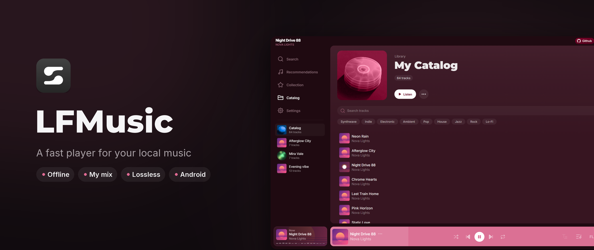
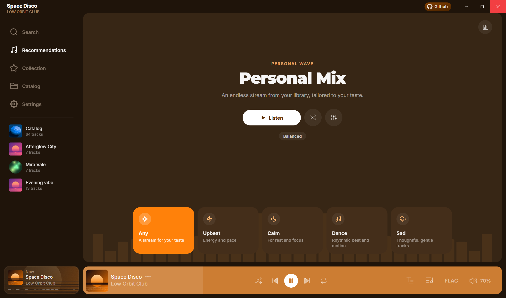
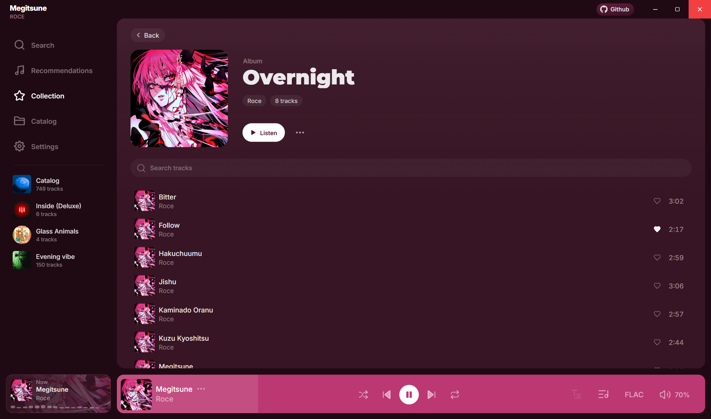
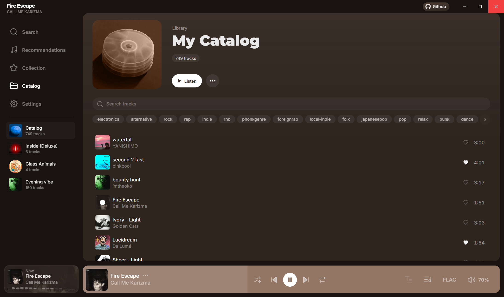
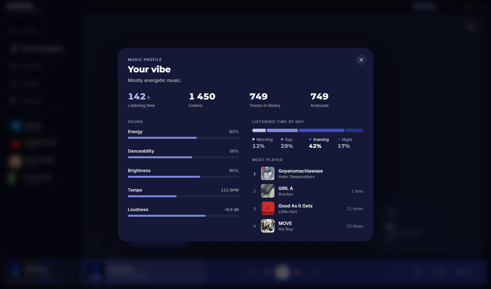
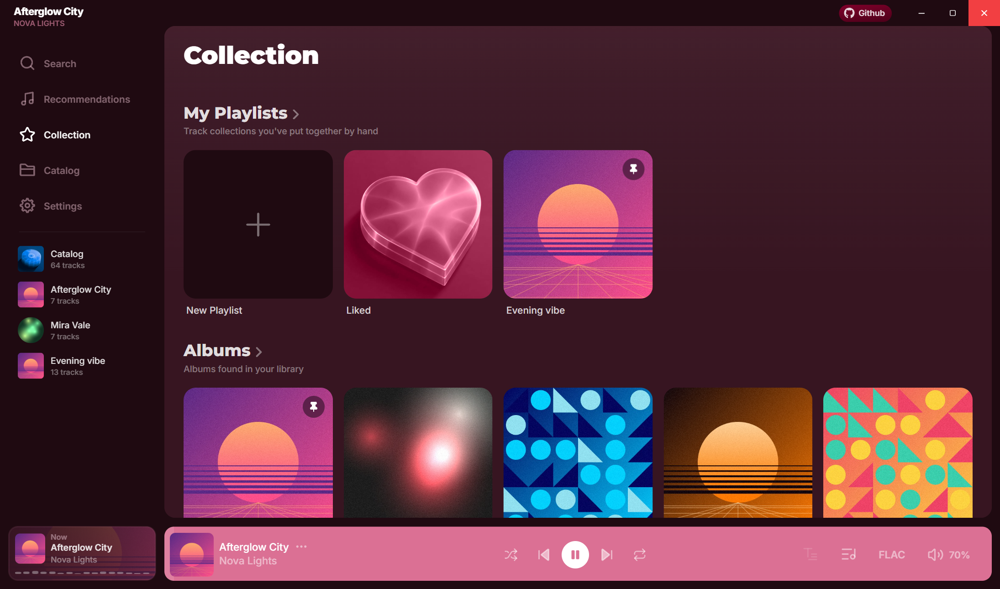
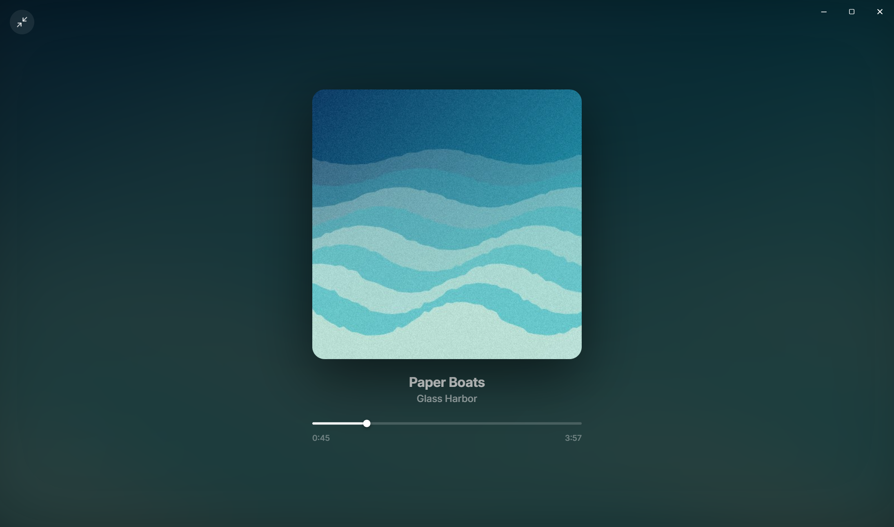
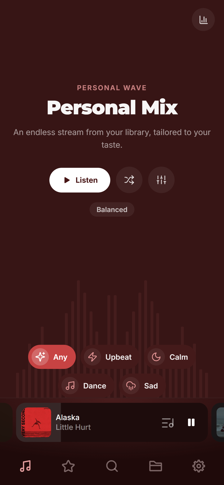
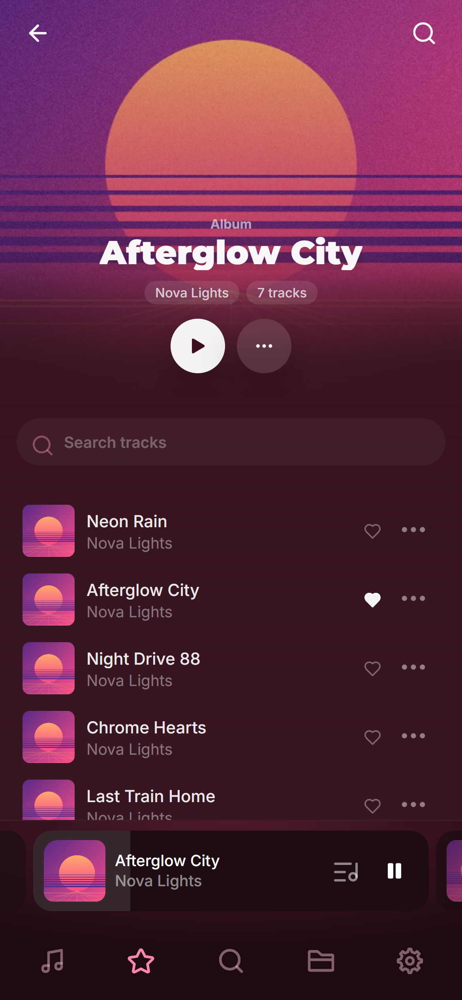

<p align="center">
  
</p>

<p align="center">
  
  
  
  
  
  
</p>

## Features

- **Your collection, not a folder.** Albums, artists, playlists and pins in the sidebar, built from the tags of your own files. Big libraries scroll smoothly.
- **Colors from the cover.** The whole app takes the accent color of the track that is playing.
- **My mix.** An endless stream from your library by mood, built from what you listen to and the sound of each track (tempo, energy, key).
- **Music profile.** Listening time, time of day, most played tracks and the sound of your taste.
- **Sound.** FLAC, ALAC, WAV, MP3, AAC, OGG and more; crossfade, equalizer, synced lyrics from `.lrc` files.
- **Grow the library.** Find a track, album or artist and download it straight into the library (desktop, optional, through yt-dlp). Covers and artist photos from free open sources.
- **Desktop and phone.** Windows, Linux and Android; taskbar buttons on Windows, MPRIS on Linux, a notification player on Android, Discord status.
- **Local first.** The library, stats and settings stay on your device. No account, no AI, no telemetry.

## Screenshots

<table>
  <tr>
    <td align="center"><br>My mix</td>
    <td align="center"><br>Album</td>
  </tr>
  <tr>
    <td align="center"><br>Catalog</td>
    <td align="center"><br>Music profile</td>
  </tr>
  <tr>
    <td align="center"><br>Collection</td>
    <td align="center"><br>Fullscreen</td>
  </tr>
</table>

<p align="center">
  
  &nbsp;&nbsp;
  
</p>

## Resources

Windows 11, Ryzen 5 5600X, a library of 3,689 tracks. Memory is the Task Manager value for the app together with its WebView2 processes.

- **Installer:** 12 MB (`setup.exe`), 23 MB portable `.exe`.
- **Window open:** 0.7 s from launch.
- **Memory:** ~185 MB, of which ~20 MB is the Rust core.
- **CPU:** ~0% when paused, ~3% of the CPU (12 threads) while playing FLAC.

## Installation

Download from the [Releases](https://github.com/mel1x/LFMusic/releases) page:

- **Windows** (x64 and ARM64): `LFMusic_*-setup.exe` installer, `.msi`, or `*_portable.exe` with no installation. Updates itself.
- **Linux**: `.AppImage`, `.deb` or `.rpm`.
- **Android**: `LFMusic_*_universal.apk`. Updates itself.

## Build

```
pnpm install
pnpm tauri dev           run with hot reload (dev.bat)
pnpm tauri build         release build (build.bat)
pnpm tauri android build --apk
```

Needs Node.js with pnpm and Rust. Screenshots and the banner: `docs/tools/screens.mjs` and `docs/tools/make-banner.py`.
